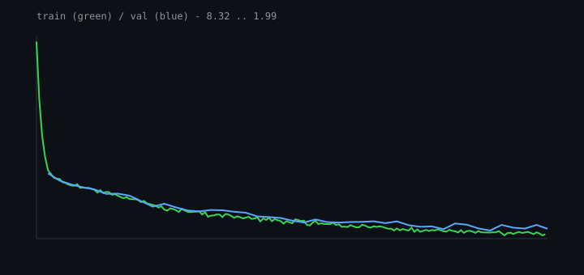
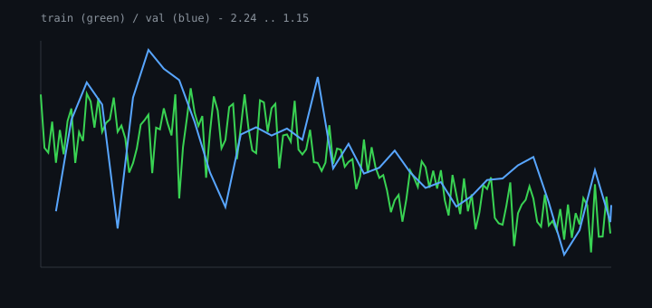

<div align="center">

# 🪶 Fully Vibecoded LLM

**A GPT-style language model, written from scratch by an AI agent — trained for free on GitHub Actions, served by NumPy, and running in your browser with zero dependencies.**

[](https://github.com/Chibbit-99/Fully-Vibecoded-LLM/actions/workflows/train_spore.yml)
[](https://github.com/Chibbit-99/Fully-Vibecoded-LLM/actions/workflows/test.yml)
[](https://chibbit-99.github.io/Fully-Vibecoded-LLM/)

</div>

---

## What this is

An experiment: **can an AI agent alone design, train and ship a language model?**
This repository is the result. It is a complete, working LLM stack with no
pretrained weights and no model zoos — every component is implemented from
first principles:

| Component | File | What it does |
|---|---|---|
| **Byte-level BPE tokenizer** | `tinyllm/tokenizer.py` | Trained from scratch on the corpus (no tiktoken, no HF tokenizers). Lossless on arbitrary UTF-8, with control tokens the tokenizer can never produce by accident. |
| **Transformer** | `tinyllm/model.py` | Decoder-only GPT: causal self-attention, pre-LayerNorm, GELU-tanh MLP, weight-tied embeddings. No `transformers` dependency. |
| **Training loop** | `scripts/train_spore.py` | Two stages (pretrain → chat tuning), AdamW, warmup + cosine decay, SFT loss masking, resumable checkpoints that survive a job being killed. Runs on **CPU**. |
| **Training infrastructure** | `.github/workflows/train_spore.yml` | GitHub Actions trains it in time-boxed chunks, caches checkpoints, publishes, and commits the artefacts back. |
| **Retrieval** | `tinyllm/retrieval.py`, `web/retrieval.js` | BM25 grounding, implemented twice (Python + JS) and tested to rank identically. This is what lets a 12M model answer factually. |
| **NumPy inference** | `tinyllm/numpy_engine.py` | Pure NumPy forward pass with an incremental KV cache. Bit-identical to PyTorch at fp32. |
| **HTTP server** | `tinyllm/server.py` | FastAPI with `/api/generate`, `/api/tokenize`, `/api/models`, `/api/model`, `/api/health`. |
| **Browser engine** | `web/engine.js` | The same forward pass in vanilla JavaScript, in a Web Worker. No WASM, no GPU, no CDN. |
| **The playground** | `web/` | The Spore chat UI. Fetches weights straight from `model/spore/`; every token is generated on your machine. Deployed to GitHub Pages. |

**The model:** **Spore** — 12M and 36M parameter chat models (exact counts,
asserted in tests), 6–12 layers, context 512, trained in two stages on
Wikipedia + TinyStories and then chat-tuned on 18k extractive Q&A records.

A model this small cannot *store* facts, so it does not try: it retrieves a
relevant passage (BM25) and answers from it. That is the honest design for the
compute available, and it is why the answers are grounded rather than invented.

## Training results

<!-- SPORE_METRICS -->
### Spore results

> Generated by `scripts/update_readme.py` from `model/spore/*/meta.json`.

| Model | Params | Stage | Steps | Val loss | Tokens seen | Last run | State |
|---|---|---|---|---|---|---|---|
| `spore-1-12M` | 12.00M | sft | 952 | 0.7656 | 3.90M | 2.4ks | complete |

<p align="center"></p>
| `spore-1-36M` | 36.00M | sft | 3,706 | 1.2129 | 3.79M | 7.8ks | complete |

<p align="center"></p>
<!-- /SPORE_METRICS -->

---

## Quick start

```bash
git clone https://github.com/Chibbit-99/Fully-Vibecoded-LLM
cd Fully-Vibecoded-LLM
make install          # venv + CPU PyTorch + server deps
```

Or, without make:

```bash
python -m venv .venv && source .venv/bin/activate
pip install -r requirements.txt
```

### 1 · The browser playground (no server, no GPU)

```bash
python scripts/build_spore_data.py   # ~2 s: builds the retrieval factbook
python scripts/serve_web.py          # then open http://localhost:8080/
```

`web/` is the whole site. The page fetches `model/spore/<name>/weights.json`
and `data/spore/factbook.json` once, then **every token is generated on your
machine** in a Web Worker. No inference API, no API key.

### 2 · The Python inference server

```bash
python -m tinyllm.server --port 8000
```

```bash
# a chat turn is a prompt in the format the model was tuned on
curl -s localhost:8000/api/generate -H 'content-type: application/json' \
  -d '{"prompt": "<|user|>Who is Michael Jordan?", "max_tokens": 60}'
```

```json
{
  "prompt": "<|user|>Who is Michael Jordan?",
  "completion": " American former basketball player...",
  "grounding": "Michael Jeffrey Jordan (born February 17, 1963) ...",
  "retrieved": {"title": "Michael Jordan", "score": 8.41},
  "tokens_generated": 60,
  "usage": {"prompt_tokens": 612, "completion_tokens": 60},
  "timings": {"tokens_per_second": 36.7},
  "engine": "numpy"
}
```

The server retrieves a passage for the prompt automatically and returns it as
`grounding`, so you can see exactly what the answer was copied from.

The server needs **no PyTorch** — just `numpy` and `fastapi`. It also serves the
same playground at `/`, so one process gives you both.

| Endpoint | Method | Purpose |
|---|---|---|
| `/api/generate` | `POST` / `GET` | Complete a prompt. Body: `prompt`, `max_tokens`, `temperature`, `top_k`, `top_p`, `seed`, `stop`. Retrieves grounding for chat prompts and returns it. |
| `/api/tokenize` | `POST` | Show the BPE tokenization, including per-token pieces. |
| `/api/models` | `GET` | Every published checkpoint under `model/spore/`. |
| `/api/health` | `GET` | Liveness + model metadata. |
| `/api/model` | `GET` | Hyper-parameters, parameter count, validation metrics. |

### 3 · The CLI

```bash
python -m tinyllm info      # parameters, config, training metrics
python -m tinyllm chat      # interactive
python -m tinyllm tokenize "To be, or not to be"
```

---

## Spore — how it answers questions

A 12M-parameter model cannot memorise Wikipedia. Pretending otherwise produces
a model that confidently invents things. Spore does the opposite:

1. **Retrieve.** BM25 ranks the ~7,000 factbook passages against your question.
2. **Ground.** The best passage is prepended as `<|context|>`.
3. **Answer.** The model copies the answer out of that passage and stops at
   `<|end|>`.

That is a real, honest architecture for this compute budget — and it is why the
retrieval implementation exists twice, in `tinyllm/retrieval.py` and
`web/retrieval.js`, with a test asserting both rank identically.

| Model | Parameters | Layers | Width | Context | Vocab | Weights |
|---|---|---|---|---|---|---|
| `spore-1-12M` | **12,000,000** | 6 | 384 | 512 | 3010 | ~24 MB |
| `spore-1-36M` | **36,000,000** | 12 | 480 | 512 | 5210 | ~72 MB |

The number in each name is the exact parameter count, asserted against both the
analytic formula and PyTorch in `tests/test_spore.py`.

**Data** (committed as raw text, no network needed at train time):

| Source | Size | Role |
|---|---|---|
| WikiText-2 | 10.8 MB | Real Wikipedia prose — encyclopedic register |
| TinyStories | 5.2 MB | Simple narrative English — fluent short sentences |
| Generated Q&A | 18,286 records | Extractive, context-grounded chat tuning |

**The two stages:**

| Stage | Trains on | Loss masking | Purpose |
|---|---|---|---|
| 1 · pretrain | prose | next-token everywhere | learn English |
| 2 · sft | Q&A | **assistant tokens only** | learn to answer, not to imitate questions |

Stage 2 keeps stage 1's weights but starts its own step counter and LR schedule.
Masking matters: without it the model learns to generate the *question* too, and
35% of the records were unlearnable before the context/answer bug was fixed —
both are documented in `docs/SPORE.md`.

**Resumable across jobs.** GitHub kills a job at 6 h, so training is split into
chunks. A checkpoint carries weights, AdamW moments, NumPy/Torch RNG state, the
step counter, the loss history, the best val loss **and** the early-stop counter.
Four resuming chunks produce bit-identical weights to one uninterrupted run —
that is `test_chunked_training_is_identical_to_one_run`, not a claim.

---


## Training it yourself

### On GitHub Actions (recommended — free, and the point of the repo)

**Actions → Train Spore (12M / 36M) → Run workflow.** Four runs, in order:

| # | `model` | `stage` | `chunk_minutes` | `target_tokens` |
|---|---|---|---|---|
| 1 | `spore-1-12M` | `pretrain` | `300` | *(blank → 40M)* |
| 2 | `spore-1-12M` | `sft` | `300` | *(blank → 12M)* |
| 3 | `spore-1-36M` | `pretrain` | `300` | *(blank → 40M)* |
| 4 | `spore-1-36M` | `sft` | `300` | *(blank → 12M)* |

Re-run any row until its job summary says **Stage FINISHED** — each job stops
cleanly at `chunk_minutes` (GitHub kills jobs at 6 h) and the next run resumes
from the exact step. Row 2 finishing is enough for the live demo.

Every run that has a checkpoint publishes one: a mid-stage chunk is committed as
a **preview** (`"preview": true` in `meta.json`, `preview (training)` in the
table below), and a finished stage overwrites it.

Full reference: **[docs/SPORE.md](docs/SPORE.md)**.

### Locally

```bash
python scripts/build_spore_data.py                      # corpus (~2 s, no network)

# stage 1: prose
python scripts/train_spore.py --config configs/spore_12m.json \
    --out-dir runs/spore-1-12M --stage pretrain --token-budget 40e6

# stage 2: chat tuning (picks up stage 1's weights automatically)
python scripts/train_spore.py --config configs/spore_12m.json \
    --out-dir runs/spore-1-12M --stage sft --token-budget 12e6
```

| Flag | Default | Notes |
|---|---|---|
| `--config` | – | `configs/spore_12m.json` or `spore_36m.json`. |
| `--stage` | `pretrain` | `pretrain` then `sft`. |
| `--token-budget` | – | Total tokens for the stage; steps are derived from it. |
| `--chunk-minutes` | 0 | Stop after N minutes and save (0 = run to completion). |
| `--export` | off | Write `weights.json` even if the stage is unfinished. |
| `--resume` | `last.pt` | Continue from a checkpoint with optimizer + RNG state. |
| `--early-stop-patience` | 4 | Evals without improvement before stopping. **Ignored under `--chunk-minutes`** — a stage split across jobs must not be killed by one chunk's stall. |

Artefacts land in `runs/spore-1-12M/`:

```
tokenizer.json    byte-level BPE vocabulary + control tokens
config.json       model hyper-parameters
last.pt           fully resumable checkpoint (weights, AdamW, RNG, patience)
weights.json      float16 export used by the NumPy + JS engines
train_log.json    meta + loss history
loss_curve.svg    dependency-free chart
samples.txt       chat samples after SFT
```

---

## How it works

### The architecture

```
tokens ──▶ Embedding + positional embedding
            │
            ▼  × n_layer (6 at 12M, 12 at 36M)
        ┌──────────────────────────────┐
        │ LayerNorm → Multi-head Attn  │
        │      + residual              │
        │ LayerNorm → MLP (GELU-tanh)  │
        │      + residual              │
        └──────────────────────────────┘
            │
            ▼  LayerNorm → Linear (tied to embedding)
          logits → temperature / top-k / top-p → next token
```

One design decision drives the whole repo: **the forward pass is deliberately
plain.** No flash attention, no fused kernels, no framework magic. Every
operation is a small function that has an exact twin in NumPy and JavaScript.
That is why the browser runs the identical model — the same weights, the same
sampler, the same stop tokens.

### Three engines, one model

```
                ┌──────────────┐
   training ───▶│  PyTorch GPT │  tinyllm/model.py
                └──────┬───────┘
                       │ export_checkpoint()  (fp16 JSON)
                       ▼
        model/spore/<name>/weights.json
                 │           │
        ┌────────▼──┐   ┌────▼─────────┐
        │  NumPy    │   │ JavaScript   │
        │  server   │   │ in-browser   │
        └───────────┘   └──────────────┘
```

Correctness is enforced by tests, not trust:

* `test_numpy_engine_matches_torch_exactly` — fp32 NumPy logits match PyTorch to `1e-4`.
* `test_percent_encoding_of_specials_matches_python_and_js` — the JS tokenizer must produce the same ids as Python for control tokens and arbitrary UTF-8.
* `test_js_retrieval_matches_python` — BM25 in the browser must rank a query exactly as the server does, or the two demos ground on different passages.
* `test_kv_cache_matches_full_forward` — the incremental cache used in generation gives the same answer as a full forward pass.

`scripts/spore_smoke.mjs` runs the whole browser stack headless against a real
checkpoint — tokenizer, factbook, engine, sampling — so "it works in Chrome" is
not the only evidence that it works.

### Why bytes and not characters?

The tokenizer learns its merges from the corpus itself. Starting from raw bytes means the vocabulary can encode *any* input — emoji, Unicode, code — without an `<unk>` token, and the same JSON vocabulary works in Python and JS with no BPE libraries. On the Spore corpus it compresses English ~2.5×; the vocab size is one config
value (3010 at 12M, 5210 at 36M).

### Bits per byte, not just loss

Cross-entropy over tokens is not comparable across tokenizers. The trainer also
reports **bits per byte** (`val_loss / ln2 / compression_ratio`), the
tokenizer-independent metric used by the GPT papers. Random guessing over 256
bytes is 8.0; checkpoints in this repo land in the 2–3 range, which is
respectable for the parameter count and honestly short of a real LM.

---

## Repository layout

```
tinyllm/              the library
  config.py           GPTConfig — single source of truth
  tokenizer.py        byte-level BPE (train / encode / decode / save)
  model.py            PyTorch GPT + sampling + KV cache
  numpy_engine.py     NumPy inference + checkpoint exporter
  dataset.py          text loading and batching
  server.py           FastAPI inference server
  cli.py              `python -m tinyllm ...`
  sft.py              chat templates + masked SFT loss
  retrieval.py        BM25 factbook used to ground Spore's answers
scripts/
  train_spore.py      two-stage, resumable Spore trainer
  build_spore_data.py WikiText + TinyStories -> prose, Q&A, factbook
  download_data.py    fetch the raw corpus
  serve_web.py        static server for the playground
  spore_smoke.mjs     headless end-to-end check of the browser stack
web/                  the Spore playground (this is the whole site)
  index.html          the chat page
  spore.js            UI: model discovery, prompt rendering, streaming
  style.css           styles (self-contained)
  engine.js           transformer forward pass in JavaScript
  tokenizer.js        BPE port (special tokens included)
  retrieval.js        BM25 port, identical ranking to the Python version
  worker.js           Web Worker wrapper
tests/                pytest suite (unit + continuation + API)
configs/              spore_12m.json, spore_36m.json
data/                 raw_wikitext2.txt, raw_tinystories.txt
  spore/              generated prose, qa.jsonl, factbook.json (gitignored)
model/                trained artefacts (committed by CI)
  spore/<name>/       Spore checkpoints + meta + samples
.github/workflows/    train_spore.yml, test.yml
```

## Going bigger

The design does not care how large the model is. To scale:

1. Add a config modelled on `configs/spore_36m.json` — the shape is the only input.
2. Add it to the `model` choice list in `.github/workflows/train_spore.yml`.
3. Raise `target_tokens`.

Measured on a 2-core `ubuntu-latest` runner: **1,235 tok/s at 12M** and
**579 tok/s at 36M**. Beyond ~100M you want a GPU runner
(`runs-on: [self-hosted, gpu]`), and the exported JSON would want a binary
format for the browser.

## Honest limitations

* **It's a tiny model.** It answers questions *when retrieval hands it the right
  passage*. It does not reason, and it will be visibly rough on anything open-ended.
* **Retrieval is load-bearing.** Turn it off and the answers degrade to fluent
  nonsense — that is the honest ceiling of 12M parameters, not a bug.
* **CPU training only.** ~1.2k tok/s at 12M is why the shipped models are small.
* **The browser engine is single-threaded.** ~35 tok/s at 12M on a laptop —
  fast enough to watch, not fast enough for a chat product.
* **Float16 weights.** A 12M model is a 32 MB JSON in the repo. Fine for a demo;
  a binary format would be ~4× smaller.

## License

Code MIT. WikiText-2 is CC BY-SA 3.0; TinyStories is CDLA-Sharing-1.0. Both are
committed as raw text under `data/` so training needs no network access.

<div align="center"><sub>Built end-to-end by an AI agent on Arena.ai · no pretrained weights were harmed</sub></div>
