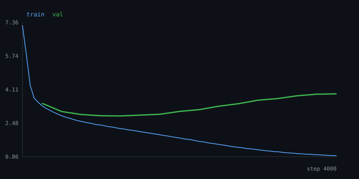

<div align="center">

# 🪶 Fully Vibecoded LLM

**A GPT-style language model, written from scratch by an AI agent — trained for free on GitHub Actions, served by NumPy, and running in your browser with zero dependencies.**

[](https://github.com/Chibbit-99/Fully-Vibecoded-LLM/actions/workflows/train.yml)
[](https://github.com/Chibbit-99/Fully-Vibecoded-LLM/actions/workflows/test.yml)
[](https://chibbit-99.github.io/Fully-Vibecoded-LLM/)

</div>

---

## What this is

An experiment: **can an AI agent alone design, train and ship a language model?** This repository is the result. It is a complete, working LLM stack with no pretrained weights and no model zoos — every component is implemented from first principles:

| Component | File | What it does |
|---|---|---|
| **Byte-level BPE tokenizer** | `tinyllm/tokenizer.py` | Trained from scratch on the corpus (no tiktoken, no HF tokenizers). Lossless on arbitrary UTF-8. |
| **Transformer** | `tinyllm/model.py` | Decoder-only GPT: causal self-attention, pre-LayerNorm, GELU-tanh MLP, weight-tied embeddings. No `transformers` dependency. |
| **Training loop** | `scripts/train.py` | AdamW, warmup + cosine decay, grad accumulation, KV-cached sampling, resumable checkpoints. Runs on **CPU**. |
| **Training infrastructure** | `.github/workflows/train.yml` | GitHub Actions trains it, caches checkpoints, runs the test suite, commits the artefacts back. |
| **NumPy inference** | `tinyllm/numpy_engine.py` | Pure NumPy forward pass with an incremental KV cache. Bit-identical to PyTorch at fp32. |
| **HTTP server** | `tinyllm/server.py` | FastAPI with `/api/generate`, `/api/tokenize`, `/api/health` and streaming-friendly JSON. |
| **Browser engine** | `web/engine.js` | The same forward pass in vanilla JavaScript, in a Web Worker. No WASM, no GPU, no CDN. |
| **Demo** | `web/index.html` | Type a prompt, watch tokens stream in. Deployed automatically to GitHub Pages. |

**The model:** TinyGPT — **3.54M parameters**, 4 layers, 4 heads, d_model 256, context window 192 tokens, 1280-token BPE vocabulary, trained on [Tiny Shakespeare](https://github.com/karpathy/char-rnn) (public domain, ~1.1 MB). Exact metrics are generated below by the training workflow.

It does not know any facts. It writes Shakespeare-flavoured English at a character level. That is exactly the point for an experiment about *building the machinery*, not about beating benchmarks.

<!-- TRAINING_METRICS -->
## Training results

> Generated by `scripts/update_readme.py` from `model/meta.json` — the numbers below
> describe the exact weights committed in `model/weights.json`.

| Metric | Value |
|---|---|
| Parameters | **2.05M** (2,050,176) |
| Architecture | 4 layers · 4 heads · d_model 192 · context 128 |
| Vocabulary | 1280 byte-BPE tokens |
| Optimiser steps | **4,000** |
| Tokens seen | 32.77M (32,768,000) |
| Validation loss | **3.9589** nats/token |
| Bits per byte | **2.968** (8.0 = random bytes) |
| Training time | 22 min on CPU 25,276 tok/s |
| Loss trajectory | 3.442 → 3.897 |

<p align="center"></p>
<p align="center"><sub>train loss in blue, validation loss in green — rendered by scripts/train.py</sub></p>

<details>
<summary><b>Sample generation</b> (from the committed weights)</summary>

```
ROMEO:
It is a flatterer, but I am swift to you for the
velarge-man purpose.

First Servingman:
And I'll hang on, and shall have a bedly here
That I should bear thee to this good condition.

CAPULET:
Go, get you hence; path like brief, disformion,
Or will I the sudden of men of of your reason
To the admir of here by the that your ine and humbering and be be instrage there.

GLOUCESTER:
You, better Richard----------
B
```

</details>
<!-- /TRAINING_METRICS -->

---

## Quick start

```bash
git clone https://github.com/Chibbit-99/Fully-Vibecoded-LLM
cd Fully-Vibecoded-LLM
make install          # venv + CPU PyTorch + server deps
```

Or, without make:

```bash
python -m venv .venv && source .venv/bin/activate
pip install -r requirements.txt
```

### 1 · The browser demo (no server logic, no GPU)

```bash
python scripts/serve_web.py          # then open http://localhost:8080/web/
```

The weights (`model/weights.json`, ~9 MB — float16 buffers base64-encoded) are fetched once, then **every token is generated on your machine** in a Web Worker. No inference API is involved.

### 2 · The Python inference server

```bash
python -m tinyllm.server --port 8000
```

```bash
curl -s localhost:8000/api/generate -H 'content-type: application/json' \
  -d '{"prompt": "ROMEO:", "max_tokens": 120, "temperature": 0.8, "top_k": 40, "top_p": 0.95}'
```

```json
{
  "prompt": "ROMEO:",
  "completion": "What is the matter?\n\nBENVOLIO:\nBut soft, what light...",
  "text": "ROMEO:What is the matter?...",
  "tokens_generated": 120,
  "finish_reason": "length",
  "usage": {"prompt_tokens": 3, "completion_tokens": 120},
  "timings": {"total_ms": 4210.5, "tokens_per_second": 28.5},
  "engine": "numpy"
}
```

The server needs **no PyTorch** — just `numpy` and `fastapi`. It also serves the demo at `/` so one process gives you both.

| Endpoint | Method | Purpose |
|---|---|---|
| `/api/generate` | `POST` / `GET` | Complete a prompt. Body: `prompt`, `max_tokens`, `temperature`, `top_k`, `top_p`, `seed`, `stop`, `system_prompt`. |
| `/api/tokenize` | `POST` | Show the BPE tokenization, including per-token pieces. |
| `/api/health` | `GET` | Liveness + model metadata. |
| `/api/model` | `GET` | Hyper-parameters, parameter count, validation metrics. |

### 3 · The CLI

```bash
python -m tinyllm generate "HAMLET:" -n 200 -t 0.9
python -m tinyllm chat      # interactive
python -m tinyllm info      # parameters, config, training metrics
python -m tinyllm tokenize "To be, or not to be"
```

---

## Training it yourself

### On GitHub Actions (recommended — free, and the point of the repo)

**Actions → Train TinyLLM → Run workflow.** Inputs let you set the step count, batch size, seed and a time budget. The job:

1. restores the checkpoint cache (so re-runs *resume* instead of restarting),
2. trains on CPU with the committed tokenizer,
3. runs the full test suite including cross-engine parity,
4. exports `model/weights.json` (+ config, metadata, loss curve, samples),
5. commits `model/` back to the branch — which triggers the Pages deployment.

A full 2 400-step run takes roughly 40–60 minutes on a 2-core `ubuntu-latest` runner. Change the inputs to train longer.

### Locally

```bash
python scripts/train.py --out-dir runs/main --config configs/small.json --max-steps 2400
```

| Flag | Default | Notes |
|---|---|---|
| `--config` | – | JSON file with model shape (see `configs/`). |
| `--max-steps` | 2400 | Optimiser steps. |
| `--batch-size` | 32 | Micro-batch. |
| `--grad-accum` | 1 | Effective batch = `batch_size × grad_accum`. |
| `--lr` | 9e-4 | Peak LR (warmup + cosine decay to `--min-lr`). |
| `--time-budget` | 0 | Stop after N minutes (0 = none). |
| `--resume` | – | Continue from `last.pt` with optimizer state. |

Artefacts land in `runs/main/`:

```
tokenizer.json    byte-level BPE vocabulary
config.json       model hyper-parameters
model.pt          PyTorch checkpoint
weights.json      float16 export used by the NumPy + JS engines
meta.json         training metrics
loss_curve.svg    dependency-free chart
samples.txt       generations at the end of training
```

---

## How it works

### The architecture

```
tokens ──▶ Embedding + positional embedding
            │
            ▼  × 4 blocks
        ┌──────────────────────────────┐
        │ LayerNorm → Multi-head Attn  │
        │      + residual              │
        │ LayerNorm → MLP (GELU-tanh)  │
        │      + residual              │
        └──────────────────────────────┘
            │
            ▼  LayerNorm → Linear (tied to embedding)
          logits → temperature / top-k / top-p → next token
```

One design decision drives the whole repo: **the forward pass is deliberately plain.** No flash attention, no fused kernels, no framework magic. Every operation is a small function that has an exact twin in NumPy and JavaScript. That is why the browser can run the identical model.

### Three engines, one model

```
                ┌──────────────┐
   training ───▶│  PyTorch GPT │  tinyllm/model.py
                └──────┬───────┘
                       │ export_checkpoint()  (fp16 JSON)
                       ▼
              model/weights.json
                 │           │
        ┌────────▼──┐   ┌────▼─────────┐
        │  NumPy    │   │ JavaScript   │
        │  server   │   │ in-browser   │
        └───────────┘   └──────────────┘
```

Correctness is enforced by tests, not trust:

* `test_numpy_engine_matches_torch_exactly` — fp32 NumPy logits match PyTorch to `1e-4`.
* `test_parity.py` — exports logits and a greedy completion from the NumPy engine, runs `scripts/js_parity.mjs` under Node, and requires the JS engine to reproduce them (tokenizer ids, argmaxes and generated text).
* `test_kv_cache_matches_full_forward` — the incremental cache used in generation gives the same answer as a full forward pass.

In this repo the measured agreement is **max |Δlogit| ≈ 2e-4** between PyTorch and the browser at float16 weights — i.e. the same model, not a re-implementation that drifts.

### Why bytes and not characters?

The tokenizer learns its merges from the corpus itself. Starting from raw bytes means the vocabulary can encode *any* input — emoji, Unicode, code — without an `<unk>` token, and the same JSON vocabulary works in Python and JS with no BPE libraries. On Tiny Shakespeare it compresses the text ~1.9×; on a bigger corpus it would learn more merges (the vocab size is one config value).

### Bits per byte, not just loss

Cross-entropy over tokens is not comparable across tokenizers. The training script also reports **bits per byte** (`val_loss / ln2 / compression_ratio`), the tokenizer-independent metric used by the GPT papers. Random guessing over 256 bytes would be 8.0; a good small Shakespeare model lands around 1.5–1.8.

---

## Repository layout

```
tinyllm/              the library
  config.py           GPTConfig — single source of truth
  tokenizer.py        byte-level BPE (train / encode / decode / save)
  model.py            PyTorch GPT + sampling + KV cache
  numpy_engine.py     NumPy inference + checkpoint exporter
  dataset.py          Tiny Shakespeare loading and batching
  server.py           FastAPI inference server
  cli.py              `python -m tinyllm ...`
scripts/
  train.py            CPU training + export + plots + samples
  download_data.py    fetch the dataset
  serve_web.py        static server for the demo
  js_parity.mjs       Node harness comparing JS to the Python reference
web/                  zero-dependency browser demo
  index.html, style.css, app.js
  engine.js           transformer forward pass in JavaScript
  tokenizer.js        BPE port
  worker.js           Web Worker wrapper
tests/                pytest suite (unit + cross-engine parity + API)
configs/              model shapes
data/                 tinyshakespeare.txt (public domain)
model/                trained artefacts (committed by CI)
.github/workflows/    train.yml, test.yml, pages.yml
```

## Going bigger

The design does not care how large the model is. To scale:

1. Edit `configs/small.json` (or add a new config) — e.g. `n_layer: 6, n_embd: 384, block_size: 256`.
2. Point the workflow at it, or pass it to `scripts/train.py`.
3. Increase `--max-steps` and `--time-budget`.

On a GitHub runner expect roughly 2 000–3 000 tokens/s; a 6M-parameter model at 10k steps is a comfortable overnight-ish run split over the checkpoint cache. Beyond ~20M parameters you will want a GPU runner (`runs-on: [self-hosted, gpu]`), but nothing else changes — and the exported JSON format would want a binary variant for the browser.

## Honest limitations

* **It's a tiny model.** No instruction following, no reasoning, no facts. It continues Shakespeare-flavoured text.
* **CPU training only.** Throughput is ~2.5k tokens/s; this is why the shipped model is small.
* **The browser engine is single-threaded.** On the 3.5M model expect tens of tokens/second depending on hardware — fast enough to watch, not fast enough for a chat product.
* **Float16 weights.** Chosen so the browser payload stays ~9 MB for 3.5M parameters. The quality cost is nil for generation; the parity tests quantify it.

## License

Code MIT. Tiny Shakespeare is public domain (it is in the `data/` folder verbatim from [karpathy/char-rnn](https://github.com/karpathy/char-rnn)).

<div align="center"><sub>Built end-to-end by an AI agent on Arena.ai · no pretrained weights were harmed</sub></div>
